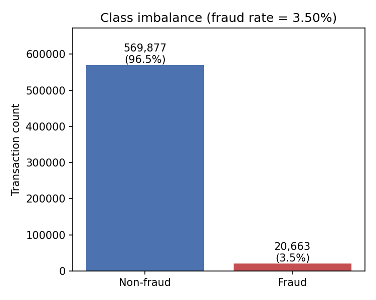
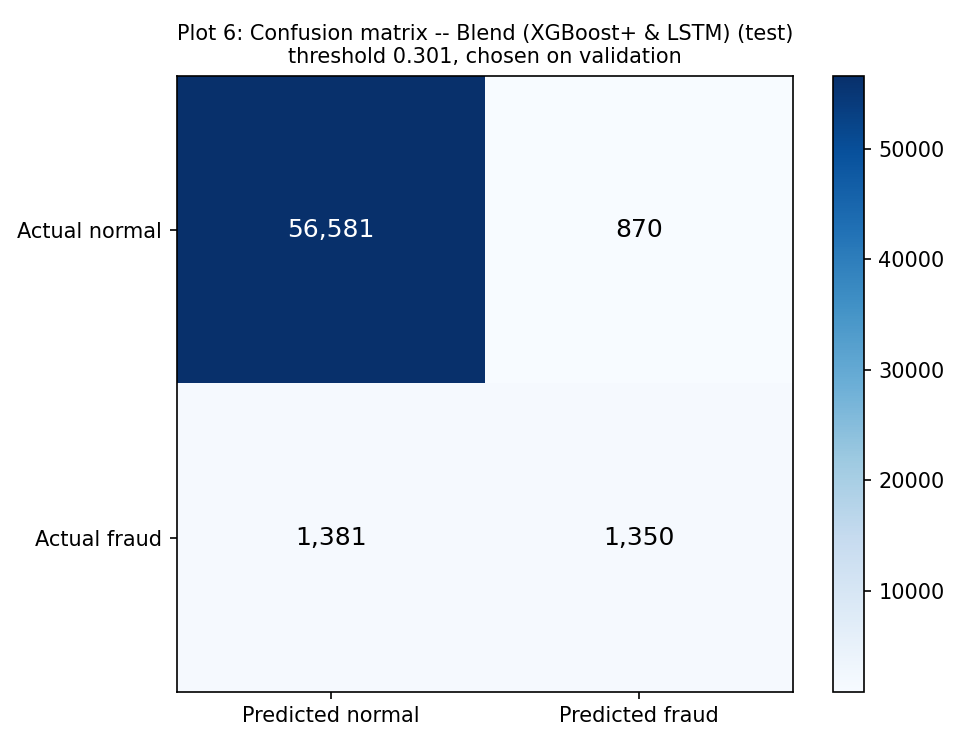
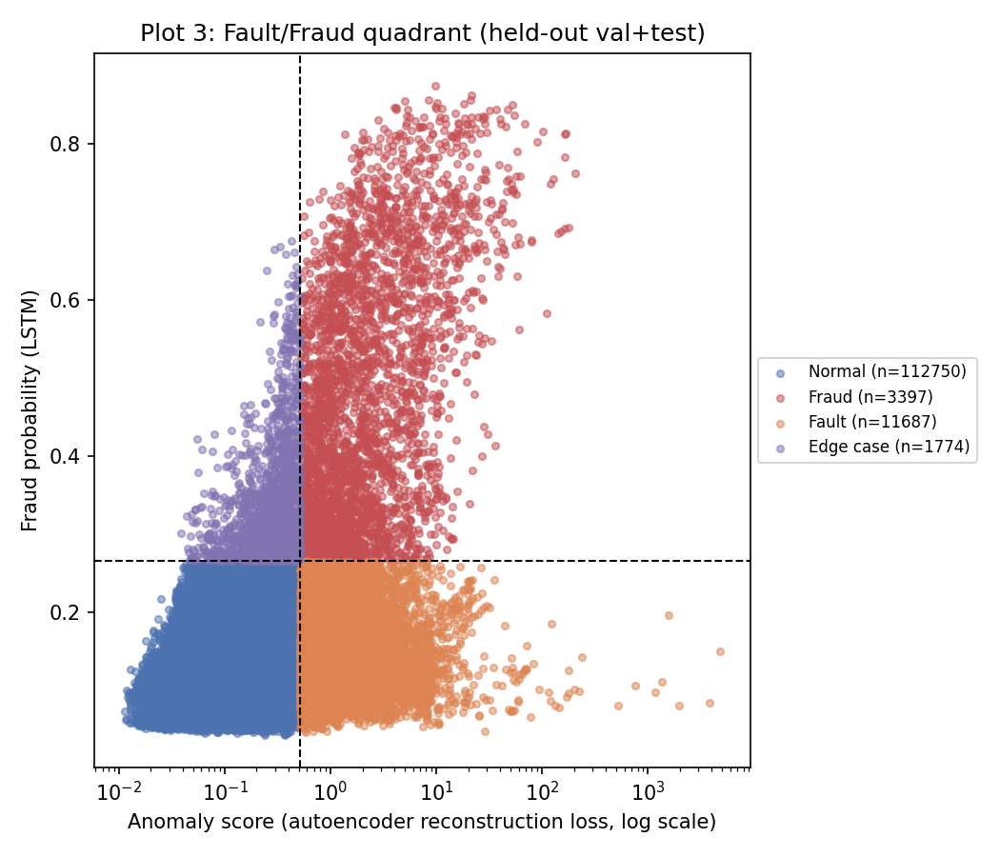

# Sequential Fault & Fraud Detection -- Project Report

*Predicting fraud probability from evolving transaction histories, with fault/fraud separation.*

> **Read this first.**
> - **Data and code:** every number in this report comes from one run of the full pipeline on the **real IEEE-CIS Fraud Detection data** (590,540 transactions), in a CPU-only Kaggle notebook, with code version **v5** (commit `d393f9c`).
> - **Headline:** the project's original thesis -- that a sequence model beats classical ML by using card history -- is **not supported** on the real data. Gradient-boosted trees with richer features are the best models, adding card-history features to them did not help, and the LSTM/Transformer are behind (Sections 4 and 6).
> - **Artifacts:** the figures, metrics and samples under `reports/` are the outputs of this same run and match the numbers below (model checkpoints are gitignored and not committed).
> - **Statistical caution:** no confidence intervals have been computed yet. Differences of about 0.01 AUC-ROC or PR-AUC between models should not be over-read (Section 7).

## 1. Problem statement

Traditional fraud detection scores each transaction in isolation and treats every anomaly as fraud. This project set out to:

1. model a cardholder's transactions as an ordered **sequence**, predicting a fraud probability that updates as each new transaction arrives, so the model can use velocity, category drift, and deviation from the user's own baseline -- signals a single-transaction model cannot see;
2. separate flagged transactions into **fraud** (malicious) vs. **fault** (a non-malicious anomaly: a technical error, a mistyped detail, a legitimate but unusual purchase) using a combined supervised + anomaly-detection design, since the dataset only labels `isFraud` and "fault" has no ground truth at all.

## 2. Dataset

**Dataset:** [IEEE-CIS Fraud Detection](https://www.kaggle.com/c/ieee-fraud-detection) (Kaggle, public): `train_transaction.csv` and `train_identity.csv`, joined on `TransactionID`, binary `isFraud` label, and no explicit user/card identifier.

**This run:** 590,540 transactions, fraud rate **3.50%**. Missing values: `card_category` 1,571, `addr1` 65,706. Of the 414 extension and extra raw columns (C/D/V, identity fields, distances, ...), 399 have missing values (mean missing fraction 45.7%, max 99.2%).

**Cards are derived, not given.** IEEE-CIS has no user id, so `card_id` is a heuristic: `card1, card2, card3, card5` plus the account start day `floor(TransactionDT/86400 - D1)` (`src/sfraud/data/merge.py`, `_derive_card_id`). The candidate keys were compared on this data -- `card1/2/3/5` alone produced a 14,112-transaction "card" (an issuer/product bucket, not a person), and adding `addr1` over-fragments because it is blank on ~11% of rows. The chosen key gives:

- **161,453 cards**: 149,167 "real" cards plus 12,286 rows missing a core field or `D1`, each treated as its own single-transaction card;
- history length per card: mean 3.66, **median 1**, p90 8, p95 13, max 1,414;
- among the 149,167 real cards: median 2, p90 9, p99 32; the 10 largest cards hold 0.7% of rows.

So **at least half of all cards have a single transaction**, which limits how much any sequence model can exploit. This is an approximation -- there is no ground truth for who is who (Section 7).



A synthetic stand-in generator (`src/sfraud/data/synthetic.py`) produces the same schema and is used for tests and as a fallback when no real CSVs are present. It was used for the earlier development runs and is not used for any number in this report.

## 3. Methodology

### 3.1 Features

**Shared per-transaction features** (`src/sfraud/features/engineering.py`). Every feature that depends on a card's own history is **causal** -- at transaction *t* it only uses transactions 1..*t*-1 for that card:

| Feature | Meaning |
|---|---|
| `log_amt`, `log_time_delta` | log1p of amount and of seconds since the card's previous transaction |
| `amt_dev`, `amt_zscore` | current `log_amt` vs. the causal expanding mean/std of the card's *prior* amounts |
| `txn_hour`, `txn_dow` | time-of-day / day-of-week |
| `stab_ProductCD`, `stab_device_type`, `stab_email_domain` | does this transaction match the card's most common *prior* value for that field? |

Plus the engineered/anonymized C1-C14, D1-D15, V1-V339 (numeric, 368 columns) and M1-M9 (categorical) columns. The sequence models and logistic regression see 377 numeric features (9 base + 368 extension, z-scored on the train split, missing values filled with 0) and 15 categorical ones (6 base + 9 extension).

**Gradient-boosted table** (`src/sfraud/features/xgb_features.py`, 497 features). Trees can use much more of the raw data, so XGBoost+ gets its own table built from the same card-level split:

- C/D/V values stay NaN (the missingness pattern is informative and XGBoost handles NaN), plus per-family missing-value counts;
- extra raw columns: `card1/2/3/5`, `addr1/2`, `dist1/2`, `R_emaildomain`, `id_01..id_38`;
- frequency encodings and frequency-ranked categorical codes computed on **train rows only**;
- **20 history-derived features**, all causal: log-time-since-previous, `amt_dev`, `amt_zscore`, the transaction's position in the card's history, the `stab_*` flags, plus prior-transaction mean/std/max amount, time since the card's first transaction, rolling 1h/1d/7d transaction counts and 1d spend, and "changed since the previous transaction" flags. These were verified against a brute-force reference and by a perturbation test (changing a later transaction changes no earlier row's features).

### 3.2 Sequence construction (`src/sfraud/data/sequences.py`)

- Transactions are grouped by `card_id`, sorted chronologically, and **right-padded** to length 30; a card with more than 30 transactions is truncated to its *first* 30. This drops 35,531 of the 590,540 transactions (6.0%) -- those beyond the 30th position of cards with more than 30 transactions -- from the sequence models. The tabular models are trained on all rows.
- **Split:** cards (not rows) are ordered by first-transaction time and cut into contiguous 70/15/15 train/val/test blocks. No card spans two splits and train broadly precedes val/test in time:

| Split | Cards | Transactions (sequences) | Fraud rate |
|---|---|---|---|
| train | 113,017 | 425,401 | 3.05% |
| val | 24,218 | 69,426 | 4.97% |
| test | 24,218 | 60,182 | 4.54% |

The fraud rate rises from train to val/test, so the evaluation includes some temporal distribution shift.

### 3.3 Models

| Model | File | Role |
|---|---|---|
| Logistic Regression | `models/baseline.py` | simplest baseline |
| XGBoost (original baseline) | `models/baseline.py` | single-transaction baseline on the shared features |
| **XGBoost+** | `training/train_xgb_plus.py` | XGBoost on the 497-feature table, early stopping and a small grid scored on validation PR-AUC (picked depth 6, column sample 0.4; stopped at 558 trees) |
| XGBoost+ (no history) | `training/train_xgb_plus.py` | the same model and hyperparameters with all 20 history-derived features removed -- the fair test of whether history helps |
| LSTM | `models/lstm.py` | sequence model; outputs a fraud probability at every step, focal loss, 210,449 parameters |
| Transformer | `models/transformer.py` | hand-rolled causal self-attention encoder, focal loss, 108,817 parameters |
| Autoencoder | `models/autoencoder.py` | per-transaction anomaly head for fault detection (Section 3.4) |
| Blend | `evaluation/blend.py` | 0.85 XGBoost+ + 0.15 LSTM after Platt calibration on validation; weight chosen on validation PR-AUC |

Both neural sequence models are strictly causal (the Transformer via a triangular attention mask), verified in `tests/test_models.py`. They were trained for a fixed 15 epochs with the default hyperparameters and **were not tuned**.

### 3.4 Fault vs. fraud design

Two independent scores are combined per transaction: the LSTM's fraud probability, and an autoencoder anomaly score (reconstruction loss of a model trained only on `isFraud==0` rows, relative to the 90th percentile of normal rows' scores).

| Fraud probability | Anomaly score | Category |
|---|---|---|
| Low | Low | Normal |
| Low | High | **Fault** |
| High | High | **Fraud** |
| High | Low | Edge case (flagged for manual review) |

"High" fraud probability uses a threshold **chosen on the validation split** (the F1-optimal one, 0.2649 for the LSTM) instead of a fixed 0.5.

## 4. Model comparison

Every model is scored on the **same 60,182 test transactions (2,731 fraud)**. The sequence models only cover each card's first 30 transactions, so scoring every model on the intersection is the like-for-like comparison.

| Model | Test AUC-ROC | Test PR-AUC |
|---|---|---|
| Logistic Regression | 0.8487 | 0.3975 |
| XGBoost (original baseline) | 0.8837 | 0.5376 |
| XGBoost+ (no history features) | 0.8930 | **0.5668** |
| **XGBoost+ (with history features)** | **0.8956** | 0.5580 |
| LSTM | 0.8528 | 0.4744 |
| Transformer | 0.8502 | 0.4711 |
| Blend (0.85 XGBoost+ + 0.15 LSTM) | 0.8957 | 0.5604 |


(Scored on each model's own test rows in the earlier phases: XGBoost 0.8792 / 0.5287, XGBoost+ 0.8938 / 0.5519, XGBoost+ without history 0.8926 / 0.5606, LogReg 0.8452 / 0.3961 -- the sequence models' numbers are identical.)

What this shows:

- **The richer tree model beats the original baseline** by about +0.012 AUC and +0.02 to +0.03 PR-AUC.
- **The sequence models do not beat the trees.** The LSTM and Transformer are about 0.04 AUC and 0.08-0.09 PR-AUC behind XGBoost+. They beat only logistic regression.
- **The blend is no better than XGBoost+ alone** (0.8957 vs 0.8956 AUC; the LSTM gets 15% of the weight): the LSTM carries almost nothing the boosted model lacks.
- The published reference points the project originally set (strong supervised baselines 0.90-0.93 AUC, Kaggle winners about 0.945) were obtained on different splits and with far heavier modelling, so they are **not directly comparable** with these card-level time-split numbers.

**Decision thresholds.** AUC and PR-AUC ignore the threshold, but precision and recall depend on it, and a fixed 0.5 is meaningless across these models: at 0.5 the LSTM has precision 0.88 and recall 0.21, the Transformer 0.85 / 0.24, and the original XGBoost (trained with a 31x positive weight, which inflates its probabilities) precision 0.18 / recall 0.77. Thresholds were therefore chosen on **validation** and applied unchanged to test:

| Model | F1-optimal: precision / recall / F1 | ~70% recall target: precision / recall / F1 |
|---|---|---|
| Logistic Regression | 0.380 / 0.443 / 0.409 | 0.184 / 0.674 / 0.289 |
| XGBoost (original) | 0.545 / 0.501 / 0.522 | 0.248 / 0.699 / 0.366 |
| XGBoost+ (no history) | 0.613 / 0.497 / 0.549 | 0.290 / 0.696 / 0.410 |
| XGBoost+ | 0.575 / 0.502 / 0.536 | 0.284 / 0.695 / 0.403 |
| LSTM | 0.491 / 0.435 / 0.461 | 0.196 / 0.675 / 0.304 |
| Transformer | 0.415 / 0.474 / 0.443 | 0.188 / 0.671 / 0.293 |
| Blend | 0.608 / 0.494 / 0.545 | 0.291 / 0.692 / 0.410 |

Validation-chosen recall targets transferred well to test (target 70% gave 0.67-0.70). Operationally, XGBoost+ at its F1-optimal point flags about half the fraud at roughly 58% precision, and pushing to ~70% recall roughly halves the precision (about 0.28).



Plot 6 shows the blend at its validation-chosen threshold (0.301) on the test split: 56,581 true negatives, 870 false positives, 1,381 missed fraud and 1,350 caught (precision 0.61, recall 0.49).

## 5. Fault/fraud results

On the held-out val+test transactions (129,608 rows), using the LSTM's validation-chosen fraud threshold (0.2649) and the 90th-percentile anomaly threshold (0.518):

| Quadrant | Count |
|---|---|
| Normal | 112,750 |
| Fault | 11,687 |
| Fraud | 3,397 |
| Edge case | 1,774 |

32.7% of true fraud lands in the "Fraud" quadrant and 89.1% of true non-fraud lands in "Normal".

**There is no ground truth for "fault" on the real data.** The synthetic data had an injected `synthetic_fault_flag`; the real data has none, so the fault-recovery numbers the earlier report quoted do not exist here. What can be measured is the fraud rate inside each quadrant on the test split (derived from the error-analysis breakdown; base rate 4.54%):

| Quadrant (test) | Transactions | Fraud rate |
|---|---|---|
| Normal | 52,000 | 2.4% |
| Fault | 5,762 | 5.0% |
| Edge case | 873 | 34.0% |
| Fraud | 1,547 | 57.5% |

The anomaly score carries a modest extra signal -- the Fault quadrant's fraud rate is about twice the Normal quadrant's -- but it is still 95% non-fraud, and **whether those transactions are genuinely benign anomalies is unverified**.



Plot 3 shows the four quadrants (anomaly score on a log axis). Fraud probability rises with anomaly score, and the Fault quadrant's anomaly scores reach into the thousands, far above the 0.518 cut.

**First look at the Fault sample** (`reports/samples/fault_quadrant_review_sample.csv`: the 20 *highest-anomaly-score* Fault transactions -- the most extreme rows, not a random sample of the 11,687). This is an inspection of the file, not a validated review:

- All 20 are non-fraud, with low fraud probabilities (0.08-0.20) and anomaly scores from 94 to 4,827 (the cut is 0.518).
- They come from only 9 cards (one card has 6 of the 20, two have 3 each).
- Every amount is a whole-dollar figure between $110 and $800 (many of them round, such as 200, 500, 600, 800), and several cards repeat the same amount (for example card `11538_...` has $800 three times in its first five transactions).

That pattern -- repeated whole-dollar purchases on the same card with no fraud label -- is *consistent with* benign unusual spending, but it is equally consistent with the autoencoder reacting to extreme feature values (see the caveat above): the scores are thousands of times the threshold. Which features drive them was not examined. A proper review would sample Fault rows at random across the score range, not only the top 20.

**Autoencoder caveat.** Its validation loss (about 92-149 over training) is roughly 300 times its training loss (0.32-0.57), which suggests some validation rows have extreme values relative to the train-fitted standardization (the heavy-tailed C/D/V columns are z-scored but not clipped). This was not investigated, so the anomaly scores likely partly reflect extreme-value outliers.

## 6. Analysis

### 6.1 Does card history help?

**Not measurably, in these experiments.** The cleanest test is the ablation -- the same XGBoost+ with and without the 20 history-derived features:

| | Test AUC-ROC | Test PR-AUC | Val PR-AUC |
|---|---|---|---|
| With history | 0.8956 | 0.5580 | 0.6104 |
| Without history | 0.8930 | 0.5668 | 0.6165 |

History is +0.003 AUC but -0.009 PR-AUC on test, and the no-history model is also slightly better on validation PR-AUC. Treat this as no benefit; the improvement over the original XGBoost came from the richer raw features, NaN handling and tuning.

**AUC by how much history was available** (test, AUC-ROC; "n_seen" = the transaction's position in its card's history; full table, including PR-AUC and all models, in `reports/metrics/by_history_length_common.csv`):

| n_seen | Transactions | Fraud | XGBoost+ | XGBoost+ (no history) | LSTM | Blend |
|---|---|---|---|---|---|---|
| 1-2 | 33,578 | 1,289 | 0.912 | 0.912 | 0.871 | 0.911 |
| 3-5 | 12,496 | 662 | 0.880 | 0.876 | 0.835 | 0.881 |
| 6-10 | 7,529 | 422 | 0.875 | 0.866 | 0.836 | 0.875 |
| 11-20 | 5,047 | 286 | 0.861 | 0.855 | 0.814 | 0.860 |
| 21+ | 1,532 | 72 | 0.837 | 0.840 | 0.790 | 0.841 |

AUC **falls** as history grows, for every model including the one that cannot see history. So this is not evidence about history's usefulness; the longer-history transactions come from a different (and harder) population, and the last bucket has only 72 fraud cases. The LSTM-only stratification by a card's total history length shows the same non-improving pattern (AUC 0.892, 0.850, 0.808, 0.839, 0.825 for 1-2, 3-5, 6-10, 11-20, 21+ transactions). The earlier synthetic result -- AUC climbing with history -- was a property of the synthetic generator.


Plot 1 (AUC-ROC within each position N, all models on the test split) shows the same thing: AUC drifts down from about 0.9 at N=1 and becomes very noisy beyond N≈20 as the samples shrink, with no upward trend for any model, sequence or not. The right-hand panel is accuracy at a fixed 0.5 threshold, which is misleading here: logistic regression and the original XGBoost look far worse (accuracy 0.6-0.8) only because their positive class weighting pushes probabilities above 0.5 -- the other models sit near 0.95-0.98 simply because 95% of transactions are non-fraud. It does not mean they rank better.

### 6.2 Error analysis (LSTM, test, validation-chosen threshold 0.2649)

True positives 1,187, false positives 1,233, false negatives 1,544, true negatives 56,218 (precision 0.49, recall 0.43).

- False negatives (missed fraud) occur earlier in a card's history (mean position 5.0) than false positives (6.9); 1,255 of the 1,544 sit in the Normal quadrant and 289 in the Fault quadrant.
- False positives split 657 into the Fraud quadrant and 576 into Edge case.
- Missed fraud and false alarms both have higher mean amounts (about $187-188) than correctly caught fraud (about $127).

### 6.3 Training behaviour and calibration

- LSTM and Transformer validation metrics are noisy from epoch to epoch (LSTM val AUC 0.857-0.875, PR-AUC 0.46-0.51) with training loss still falling slowly, so they are neither clearly converged nor stable. With a fixed 15 epochs and default hyperparameters, their gap to XGBoost+ may partly reflect that; it was not tested.
- Models are not calibrated to a common scale: the F1-optimal threshold is 0.22 for XGBoost+, 0.26 for the LSTM, and 0.83 for the original XGBoost (inflated by its positive-class weight). The blend therefore calibrates each model on validation first.
- Validation scores are optimistic relative to test (XGBoost+ PR-AUC 0.61 on validation vs 0.56 on test) because validation was used for early stopping, the hyperparameter grid, calibration and thresholds, and because the fraud rate shifts over time.

### 6.4 Interpretability plots (2, 4, 7)

These plots were designed to illustrate the synthetic data's injected structure and **do not support the sequence-model story on the real data**:

- **Plot 2 (prediction traces):** the "fault" panel is empty ("no example found") because it relies on the synthetic fault label, which real data does not have. The fraud example (card `12695_490.0_150.0_226.0_155.0`, one fraud at position 12) shows the LSTM's probability rising only to about 0.24 at the fraud transaction, below the plot's dotted 0.5 line -- i.e. a missed or at best borderline case, not the clean spike the synthetic data produced. (The dotted line is a hard-coded 0.5, not the validation-chosen operating threshold of 0.2649; at that threshold this fraud sits just under the cut.)
- **Plot 4 (Transformer attention, same card):** the last-layer attention is diffuse across prior transactions, heaviest on the earliest positions, with no visible concentration on the fraudulent transaction. The "attends to the first fraudulent transaction" interpretation from the synthetic run does not appear here.
- **Plot 7 (t-SNE of the LSTM's categorical embeddings):** points (2,407 normal, 93 fraud, 0 fault) form many tight clusters that appear to reflect category combinations; fraud points are scattered across clusters, so the categorical embeddings alone show no clean fraud separation.

## 7. Limitations

- **No confidence intervals.** Test fraud counts are modest (2,731 overall, 72 in the largest-history bucket). The differences between XGBoost+ with and without history, and between the blend and XGBoost+, are small enough (at most 0.003 AUC) that they are probably noise; a bootstrap over cards would confirm this and has not been run.
- **`card_id` is an approximation.** At least half of derived cards have a single transaction, 12,286 rows are isolated because a key field is missing, and the largest derived card has 1,414 transactions (probably several accounts opened the same day in one card bucket). History features and sequence models are only as good as this grouping.
- **The sequence models are untuned and use only the first 30 transactions per card.** The negative result for them is for these hyperparameters and this card grouping, not a proof that sequence models cannot help on this data.
- **"Fault" has no ground truth** and its quadrant has only had a first look at its 20 most extreme rows (Section 5), not a proper review. Plot 2's fault panel and its 0.5 reference line also need rework for real data. The anomaly score is per-transaction (a deliberate design choice, see `models/autoencoder.py`), so it cannot detect anomalies that only appear as a pattern across several transactions, and its validation loss suggests extreme-value outliers (Section 5).
- **Temporal shift:** the fraud rate is 3.05% in train and 4.5-5.0% in val/test; thresholds chosen on validation transfer reasonably (recall targets landed close to target) but are not guaranteed to on future data.
- **`merchant_category`** does not exist in the real schema; it is derived deterministically from `ProductCD` (`data/merge.py: PRODUCT_TO_MERCHANT_CATEGORY`).
- **Single run, single seed (`seed: 42`)**, CPU-only; no repeated runs.

## 8. Reproducibility

```bash
pip install -r requirements.txt
pip install -e .
bash scripts/run_pipeline.sh
```

Every stage reads its parameters from `configs/config.yaml` and writes to `reports/figures/`, `reports/metrics/`, and `checkpoints/`. `seed: 42` is set once and threaded through numpy/random/torch (`src/sfraud/utils/seed.py`). The real-data run used a Kaggle notebook: the competition data attached as an input (`/kaggle/input/competitions/ieee-fraud-detection/`), `train_transaction.csv` and `train_identity.csv` linked into `data/raw/`, then Phases 1, 2, 3, 3b, 4, 5, 6, 6b and 7 in order (Phase 0, the Kaggle API download, is not needed inside Kaggle). Phase 3b is slow on CPU (a four-model grid plus two final fits); `xgboost_plus.search.enabled: false` in the config skips the grid. See [README.md](../README.md) for the phase-by-phase breakdown.
