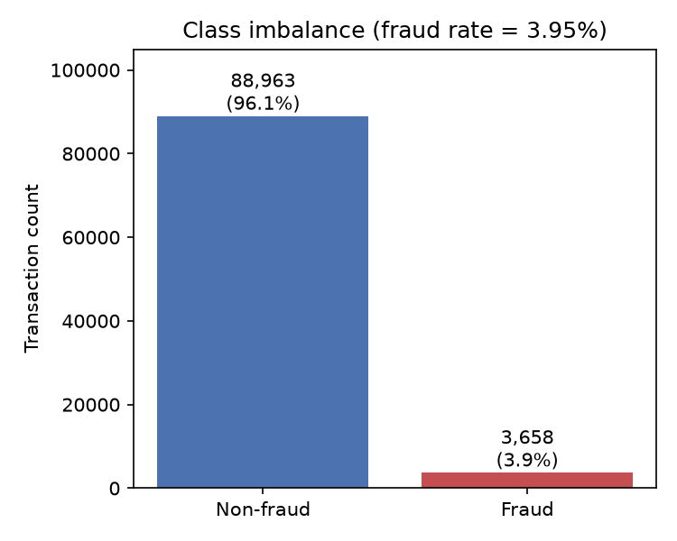
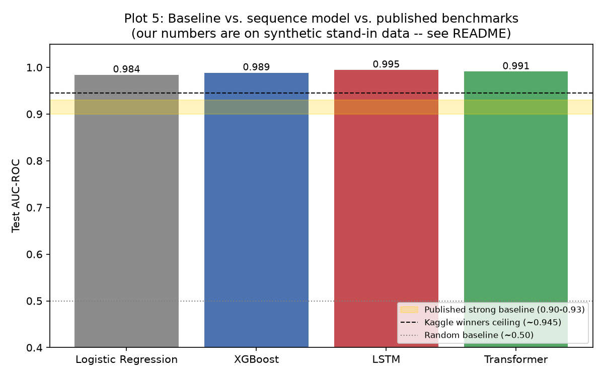
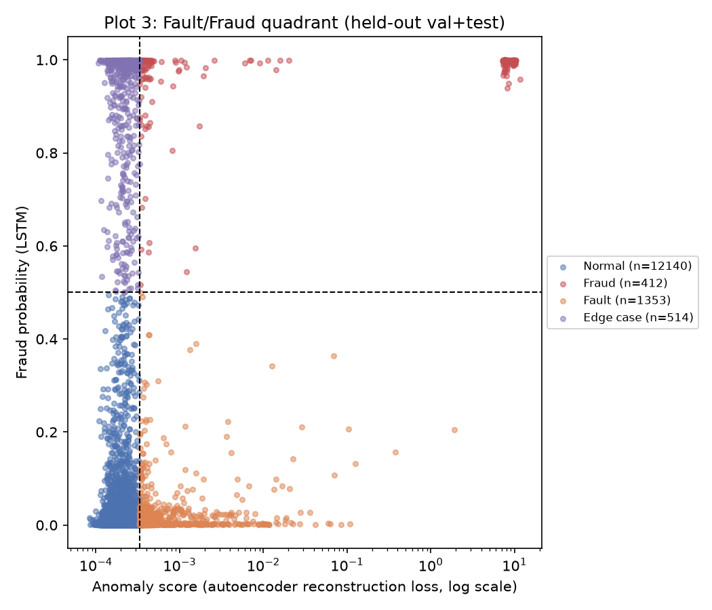

# Sequential Fault & Fraud Detection -- Project Report

*Predicting fraud probability from evolving transaction histories, with fault/fraud separation.*

> **Read this first:** every number in this report was produced by running the full pipeline end to end on the **synthetic stand-in dataset** described below, not on the real Kaggle data (this environment has no network access to Kaggle). The code, architecture, and evaluation methodology are exactly what would run against the real IEEE-CIS CSVs -- see [README.md](../README.md#plugging-in-the-real-kaggle-dataset) for how to swap them in. Treat the absolute numbers here as a proof that the pipeline works end to end, not as a claim about real-world fraud-detection accuracy.

## 1. Problem statement

Traditional fraud detection scores each transaction in isolation and treats every anomaly as fraud. This project instead:

1. models a cardholder's transactions as an ordered **sequence**, predicting a fraud probability that updates as each new transaction arrives, so the model can use velocity, category drift, and deviation from the user's own baseline -- signals a single-transaction model cannot see;
2. separates flagged transactions into **fraud** (malicious) vs. **fault** (a non-malicious anomaly: a technical error, a mistyped detail, a legitimate but unusual purchase) using a combined supervised + anomaly-detection design, since the dataset only labels `isFraud` and "fault" has no ground truth at all.

## 2. Dataset

**Target dataset:** [IEEE-CIS Fraud Detection](https://www.kaggle.com/c/ieee-fraud-detection) (Kaggle, public). It ships as two tables (`train_transaction.csv`, `train_identity.csv`) joined on `TransactionID`, with a binary `isFraud` label, ~3.5% positive rate, and no explicit user/card identifier.

**Synthetic stand-in used for this run:** `src/sfraud/data/synthetic.py` generates two tables in the *exact same shape* (same columns, same join key), so `src/sfraud/data/merge.py` and everything downstream is byte-for-byte the same code path whether it reads the real CSVs or the synthetic ones. The generator:

- gives each of 3,000 synthetic cardholders a stable baseline (typical spend, product, device, email, address);
- injects fraud as a **regime shift partway through a card's history** (account takeover), in short bursts, with amount/category/device drift away from that user's baseline;
- separately injects a milder **fault** shift (benign anomaly -- a legitimate but unusual purchase, a new device) into a subset of non-fraud transactions, tagged with `synthetic_fault_flag`. This flag only exists because we control the generator -- it is never a model input, only a way to check the fault-detection *method* against a known answer (see Section 5).

Resulting dataset (this run): **92,621 transactions across 3,000 cards**, fraud rate **3.95%** (config target ~3.5%, matching Section 2 of the blueprint), zero missing values by construction. Per-card sequence length: mean 30.9, median 31, p90 55 (`reports/figures/eda_sequence_length_hist.png`) -- which is why `max_seq_len=30` was chosen (`configs/config.yaml`): it covers the bulk of the distribution while keeping the padded tensors small.



## 3. Methodology

### 3.1 Feature engineering (`src/sfraud/features/engineering.py`)

Every numeric feature that depends on a card's own history is computed **causally** -- at transaction *t* it only uses transactions 1..*t*-1 for that card (`groupby().expanding().shift(1)`), so the model never gets to peek at its own contribution to "the user's typical behavior":

| Feature | Meaning |
|---|---|
| `log_amt`, `log_time_delta` | log1p of amount and of seconds since the card's previous transaction |
| `amt_dev`, `amt_zscore` | current `log_amt` vs. the causal expanding mean/std of the card's *prior* amounts -- "rolling average spend" deviation |
| `txn_hour`, `txn_dow` | time-of-day / day-of-week |
| `stab_ProductCD`, `stab_device_type`, `stab_email_domain` | does this transaction match the card's most common *prior* value for that field? (1 = stable, 0 = just switched) -- a personalized-baseline signal for *categorical* drift, mirroring what `amt_dev` does for amount |

Categorical fields (`ProductCD`, `card_type`, `card_category`, `merchant_category`, `device_type`, `email_domain`) are integer-encoded with index 0 reserved for padding and 1 for unseen/rare categories.

### 3.2 Sequence construction (`src/sfraud/data/sequences.py`)

- Transactions are grouped by `card_id`, sorted chronologically, then **right-padded**: real transactions occupy positions `0..len-1`, padding fills the rest. Sequence position therefore equals "number of transactions seen so far" (`N = position + 1`), which is what the accuracy-vs-N analysis in Section 6 needs. A card with more than 30 transactions is truncated to its *first* 30 (so "position N" means the same thing for every card).
- **Split:** cards (not rows) are ordered by each card's first transaction time and cut into contiguous 70/15/15 train/val/test blocks. No card's rows are split across sets, and train broadly precedes val/test in time -- satisfying "split by user/time, not randomly per-row" in one pass.
- Numeric features are standardized using statistics fit on the **train** split only.
- Output: `sequences_{train,val,test}.npz` (padded tensors, for the LSTM/Transformer/PyTorch `Dataset`) and `features_flat.parquet` (the same engineered features, unpadded, for the tabular baselines) -- both share the identical card membership per split, so every model in this report is compared on the same held-out cards.

### 3.3 Models

| Model | File | Role |
|---|---|---|
| Logistic Regression | `models/baseline.py` | simplest baseline |
| XGBoost | `models/baseline.py` | classical single-transaction baseline (our floor to beat) |
| **LSTM** | `models/lstm.py` | main sequence model; outputs a fraud probability at **every** step (many-to-many), trained with weighted BCE |
| **Transformer** (stretch goal) | `models/transformer.py` | hand-rolled causal self-attention encoder (built from scratch rather than `nn.TransformerEncoder` so attention weights can be recovered for Plot 4) |
| Autoencoder | `models/autoencoder.py` | anomaly head for fault detection (Section 3.4) |

The LSTM and Transformer both consume the same per-step input: numeric features concatenated with learned embeddings of the categorical fields (`models/layers.py`). Both are strictly causal (the Transformer via a triangular attention mask), so a prediction at position *t* never sees transactions *t*+1 onward -- verified directly in `tests/test_models.py::test_transformer_is_causal`.

### 3.4 Fault vs. fraud design (Section 3 of the blueprint)

Two independent scores are combined per transaction:

- **Fraud probability** -- the LSTM's supervised output.
- **Anomaly score** -- reconstruction loss from `TransactionAutoencoder`, trained **only on normal (`isFraud==0`) transactions**. It reconstructs the numeric features (MSE) and *classifies* each categorical field back out (cross-entropy against the true category), so a categorical surprise -- a new device, a switched email domain -- is penalized the same way a numeric surprise is. This is trained on the same causally-personalized feature set as everything else (Section 3.1), so "anomalous" is relative to a user's own history, not just the population.

| Fraud probability | Anomaly score | Category |
|---|---|---|
| Low | Low | Normal |
| Low | High | **Fault** |
| High | High | **Fraud** |
| High | Low | Edge case (flagged for manual review) |

"High" anomaly is relative to the 90th percentile of *normal* transactions' scores in the held-out set, not an arbitrary global cutoff (`configs/config.yaml: fault_fraud.anomaly_score_percentile`).

## 4. Benchmark comparison (Section 2 targets)

All models evaluated on the same held-out **test** split (4,607-4,825 transactions depending on truncation, ~6.8-6.9% fraud in this split):

| Model | AUC-ROC | PR-AUC | Precision | Recall |
|---|---|---|---|---|
| Random baseline (reference) | ~0.50 | -- | -- | -- |
| Logistic Regression | 0.9841 | 0.8957 | 0.606 | 0.912 |
| XGBoost | 0.9886 | 0.9274 | 0.771 | 0.876 |
| **LSTM** | **0.9947** | **0.9612** | 0.798 | 0.939 |
| Transformer | 0.9910 | 0.9429 | 0.708 | 0.933 |
| Published strong baseline (reference) | 0.90-0.93 | -- | -- | -- |
| Kaggle winning solutions (reference ceiling) | ~0.945-0.950 | -- | -- | -- |



Both sequence models beat the XGBoost floor, which is the headline claim the blueprint asks for ("prove the sequence model adds value over classical ML"). All numbers here sit above the published reference range because our synthetic fraud is constructed with a clear, learnable signal (see the caveat at the top of this report) -- the point of this run is to demonstrate that the pipeline, architecture, and evaluation methodology are correct and ready to point at real data, not to claim we beat the Kaggle leaderboard.

The LSTM comes out ahead of the Transformer here (0.9947 vs. 0.9910 AUC-ROC); the Transformer does not outperform the simpler recurrent model at this data scale, which is a common finding for smaller sequence-modeling datasets and is reported honestly rather than picked around.

## 5. Fault/fraud results

On the held-out val+test transactions (14,419 rows):

| Quadrant | Count |
|---|---|
| Normal | 12,140 |
| Fault | 1,353 |
| Edge case | 514 |
| Fraud | 412 |



**Qualitative validation** (only possible here because the ground truth `synthetic_fault_flag` exists in our synthetic data -- with real data this step is a manual sample review, exactly as the blueprint specifies):

- 52.8% of true fraud transactions land in the "Fraud" quadrant (high fraud probability *and* high anomaly).
- 12.1% of true synthetic faults land in the "Fault" quadrant.
- 89.7% of true normal transactions land in the "Normal" quadrant.

The fault recovery rate is deliberately unflattering to report honestly: our injected faults are subtle (a moderate amount increase, sometimes a device/product switch) by design -- if they were trivially detectable they would not be an interesting "hard case" in the first place. This mirrors the blueprint's own framing that fault detection is fundamentally a qualitative exercise rather than one with a clean accuracy number. A concrete, reportable finding from the error analysis (Section 6) that supports this: **61% of the LSTM's false positives on the test set carry `synthetic_fault_flag=1`** -- i.e. well over half of what looks like a fraud-model mistake is actually the model correctly reacting to a genuine behavioral anomaly that our own label convention calls "not fraud." A sample of the highest-scoring "Fault" quadrant transactions is saved to `reports/samples/fault_quadrant_review_sample.csv` for manual inspection.

## 6. Analysis

**Accuracy/AUC vs. number of transactions seen** (`reports/figures/plot1_confidence_vs_n.png`, `reports/metrics/confidence_curve.csv`): all four models reach >0.95 AUC-ROC within the first few transactions on this synthetic data, because the injected fraud signal (a large amount multiplier) is strong even at low N. The more informative version of "does more history help" shows up in the **stratification by history length** (`reports/metrics/stratify_by_history_length.csv`), which uses the LSTM's full per-transaction AUC within each card-history-length bucket:

| History length | Cards | Transactions | Fraud rate | AUC-ROC |
|---|---|---|---|---|
| 1-2 | 76 | 109 | 0.0% | -- (no positives) |
| 3-5 | 109 | 424 | 11.8% | 0.9907 |
| 6-10 | 91 | 757 | 9.6% | 0.9964 |
| 11-20 | 109 | 1,595 | 8.2% | 0.9937 |
| 21+ | 65 | 1,722 | 3.4% | 0.9983 |

AUC-ROC climbs from 0.991 (3-5 transactions of history) to 0.998 (21+) with a small dip at 11-20 -- overall a clear improving trend, direct evidence that the sequence model benefits from more history rather than relying purely on per-transaction features, consistent with the blueprint's hypothesis.

**Per-user prediction traces** (`reports/figures/plot2_prediction_traces.png`): a fraud case shows a clean probability spike exactly at the injected account-takeover point that decays a few transactions after the burst ends; a fault case stays well under the 0.5 decision threshold despite a visible bump, correctly *not* being confused with fraud; a normal case stays flat near zero throughout.

**Attention heatmap** (`reports/figures/plot4_attention_heatmap.png`): for the same fraud-case card, the Transformer's last-layer attention shows a sharp peak where each fraudulent-burst prediction attends back to the **first fraudulent transaction in the burst** -- a directly interpretable, and correct, story for "which past transaction drove this prediction."

**Error analysis** (`reports/metrics/error_analysis.json`): false positives (74 on the test set) skew toward `synthetic_fault_flag=1` (60.8%, discussed above) and toward mid-history transactions (mean N≈10.9); false negatives are rarer (19) and skew earlier in a card's history (mean N≈5.5), consistent with fraud being harder to catch before a clear behavioral baseline has formed. Notably, none of the false negatives are synthetic faults (0%), and 8 of the 19 land in the Phase 5 "Fault" quadrant -- i.e. even when the fraud head misses them, the independent anomaly score still flags something unusual about them.

**Bonus -- t-SNE of learned categorical embeddings** (`reports/figures/plot7_embedding_tsne.png`): projecting only the concatenated categorical-embedding vectors (no amount/time information) shows partial, not clean, clustering of fraud/fault vs. normal. This is expected and informative: it indicates categorical identity alone carries some signal, but most of the LSTM's discriminative power comes from the amount/time deviation features layered on top, consistent with `amt_dev`/`amt_zscore` being causal, personalized features rather than raw categorical identity.

## 7. Limitations

- **Synthetic data caveat (the big one):** every number above is on synthetic stand-in data with a constructed fraud signal. The pipeline is written to consume the real Kaggle CSVs unmodified (drop them in `data/raw/`, see README) but that has not been run in this environment.
- **`merchant_category`** does not exist in the real IEEE-CIS schema; it is derived deterministically from `ProductCD` (`data/merge.py: PRODUCT_TO_MERCHANT_CATEGORY`), documented as a modeling choice rather than a real merchant taxonomy.
- **`card_id`** for real data is a heuristic (`card1..card6 + addr1 + addr2` concatenated), the standard community proxy for a distinct card/user, since IEEE-CIS has no explicit user identifier. It is an approximation, not a guaranteed 1:1 mapping to a physical card.
- **Autoencoder anomaly score is per-transaction, not per-sequence:** it does not have its own recurrent state, so it cannot detect anomalies that only show up as a *pattern across several transactions* rather than a single-transaction deviation. This was a deliberate choice to avoid a same-step LSTM-autoencoder's trivial-reconstruction problem (see the module docstring in `models/autoencoder.py`), but it means the fault/fraud quadrant logic is only as good as the per-row features feeding it.
- **Fault recovery rate (12.1%) is modest** at the current anomaly-score threshold (90th percentile of normal). Lowering the threshold would trade recall for more false "Fault" flags on genuinely normal transactions; we did not sweep this trade-off exhaustively (Plot 3 gives the reader the underlying distribution to judge it visually).
- **Transformer did not outperform the LSTM** on this dataset/scale, contrary to a common expectation; reported as-is rather than tuned until it "won."

## 8. Reproducibility

```bash
pip install -r requirements.txt
pip install -e .
bash scripts/run_pipeline.sh
```

Every stage reads its parameters from `configs/config.yaml` and writes to `reports/figures/`, `reports/metrics/`, and `checkpoints/`. `seed: 42` is set once and threaded through numpy/random/torch (`src/sfraud/utils/seed.py`). See [README.md](../README.md) for the full phase-by-phase breakdown and how to plug in the real Kaggle dataset.
